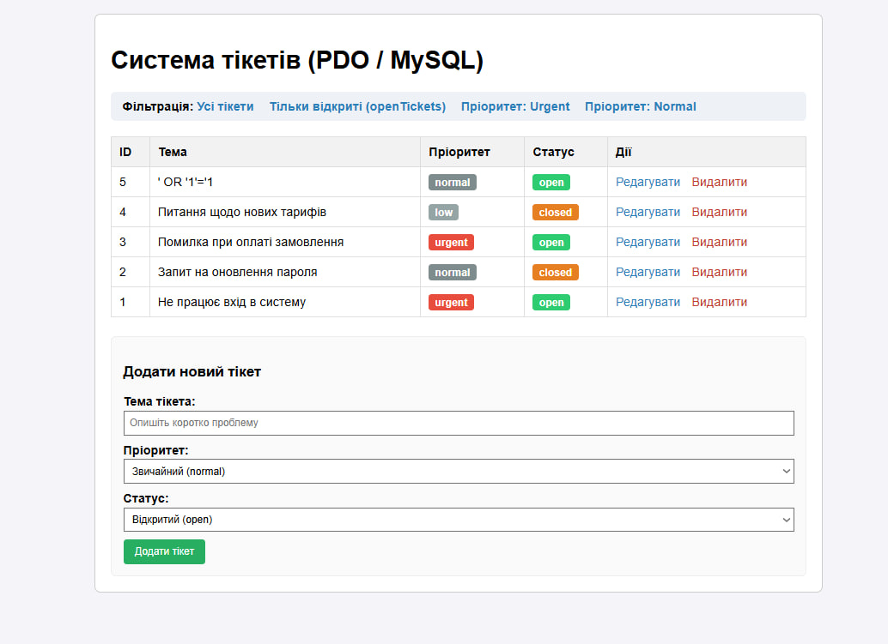

# Практична робота №4. Взаємодія вебзастосунку з базою даних (PDO/MySQL)

**Виконав:** Сизоненко Артем Олександрович  
**Група:** ІО-45

## Опис завдання
Мета роботи — навчитися підключати PHP-застосунок до бази даних MySQL/MariaDB через розширення PDO, реалізувати базові CRUD-операції (SELECT, INSERT, UPDATE, DELETE) та захист від SQL-ін'єкцій за допомогою підготовлених запитів (prepared statements).

**Варіант 19: Система тікетів служби підтримки (helpdesk)**
*   **Таблиця:** `tickets` (`id`, `subject`, `priority`, `status`).
*   **Вибірка (SELECT):** `openTickets()` (тільки відкриті тікети), `findByPriority($priority)` (фільтрація за пріоритетом).
*   **Зміна даних:**
    *   `addTicket()` — створення тікета (INSERT).
    *   `updateStatus()` — оновлення статусу та даних (UPDATE).
    *   `deleteTicket()` — видалення тікета (DELETE).

## Безпека
Усі SQL-запити виконано через підготовлені запити PDO (`$pdo->prepare()` + `$stmt->execute()`), що унеможливлює проведення SQL-ін'єкцій через параметри форми.

## Результат роботи
Скріншот розробленого інтерфейсу:



## Інструкція із запуску
1. Імпортувати `schema.sql` у MySQL/phpMyAdmin.
2. Перевірити параметри підключення в `db.php` (host, dbname, user, password).
3. Запустити вбудований PHP-сервер:
   ```bash
   php -S localhost:8000